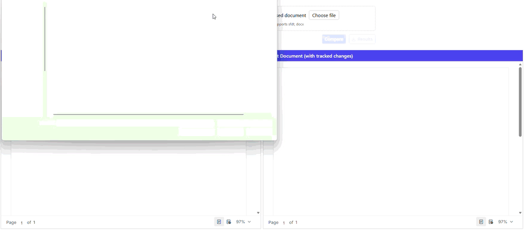

# JavaScript (ES5) DOCX Editor – Side by Side Document Comparison

## Introduction

This sample demonstrates how to compare two Word documents side by side using the Syncfusion<sup style="font-size:70%">&reg;</sup> [JavaScript (ES5) DOCX Editor](https://www.syncfusion.com/docx-editor-sdk/javascript-docx-editor?utm_source=github&utm_medium=listing&utm_campaign=github-javascript-es5-docx-editor-examples) (Document Editor). The sample allows users to upload an original and a revised document, compare them using the Document Editor web service, and view the comparison results with tracked changes.

## Prerequisites

* Visual Studio Code (optional, but recommended for editing and browsing the sample)
* A modern web browser

## How to Run the Application

Since this sample is built on plain HTML and JavaScript (ES5), no build tools or package installation are required.

### Configuration

No additional configuration is required.

This sample is already configured to use the online Syncfusion Document Editor service:

```javascript
var serviceUrl = 'https://document.syncfusion.com/web-services/docx-editor/api/documenteditor/'; //only for demo purpose.
```

Since the sample consumes the hosted web service, you do **not** need to download, build, or run any ASP.NET Core Web API project.

### Run the Application

Open `index.html` from the `Side-by-Side-Comparison` folder in a browser. Alternatively, serve the folder with any static file server (such as Visual Studio Code **Live Server**) and browse to the hosted page.

### Verify the Sample

1. Launch the application. Two editors open side by side with default documents loaded.
2. Click **Choose file** under **Original document** and select a DOCX or SFDT file.
3. Click **Choose file** under **Revised document** and select another version of the same document.
4. Click **Compare**.
5. The application sends both documents to the online Document Editor service.
6. The comparison result is displayed in the right-side editor with tracked changes (when **Show comparison results with tracked changes** is checked). Otherwise, the revised document is displayed in the right-side editor.
7. Use **Show Review Pane** to review insertions, deletions, and formatting changes.
8. Click **Download Result Document** to save the comparison result as a DOCX file with tracked changes preserved.

---

## Demo

<p align="center">
  
</p>

---

# Project Workflow

The application follows the workflow below:

1. User uploads the original document.
2. User uploads the revised document.
3. Both documents are sent to the Syncfusion online Document Editor service.
4. The service:
   - Imports the DOCX files.
   - Compares both documents.
   - Generates a document with tracked revisions.
5. The comparison result is returned in SFDT format.
6. The application loads the original document in the left editor.
7. The compared document (or revised document) is loaded in the right editor for side-by-side review.

```
Original DOCX
        │
        │
        ▼
JavaScript (ES5) Application
        │
        │
        ▼
Syncfusion Online Document Editor Service
        │
        ├── Import Original
        ├── Import Revised
        └── Compare Documents
                │
                ▼
      Compared SFDT Document
                │
                ▼
JavaScript (ES5) DOCX Editor
        │
        ├── Left Editor  → Original
        └── Right Editor → Compared / Revised
```

---

# Resources

- **Product page:**   [Syncfusion&reg; JavaScript (ES5) DOCX Editor](https://www.syncfusion.com/docx-editor-sdk/javascript-docx-editor?utm_source=github&utm_medium=listing&utm_campaign=github-javascript-es5-docx-editor-examples) 

- **Documentation:**   [Syncfusion&reg; JavaScript (ES5) DOCX Editor - Documentation](https://help.syncfusion.com/document-processing/word/word-processor/javascript-es5/overview?utm_source=github&utm_medium=listing&utm_campaign=github-javascript-es5-docx-editor-examples) 

- **Online demo:**   [Syncfusion&reg; JavaScript (ES5) DOCX Editor - Online demo](https://document.syncfusion.com/demos/docx-editor/javascript-es5/#/material3/document-editor/default.html?utm_source=github&utm_medium=listing&utm_campaign=github-javascript-es5-docx-editor-examples)

# Support and feedback 

For any other queries, reach our [Syncfusion&reg; support team](https://support.syncfusion.com/?utm_source=github&utm_medium=listing&utm_campaign=github-javascript-es5-docx-editor-examples) or post the queries through the [community forums](https://www.syncfusion.com/forums?utm_source=github&utm_medium=listing&utm_campaign=github-javascript-es5-docx-editor-examples). 

Request new feature through [Syncfusion&reg; feedback portal](https://www.syncfusion.com/feedback?utm_source=github&utm_medium=listing&utm_campaign=github-javascript-es5-docx-editor-examples). 

# License

This is a commercial product and requires a paid license for possession or use. Syncfusion's licensed software, including this component, is subject to the terms and conditions of [Syncfusion's EULA](https://www.syncfusion.com/license/studio/22.2.5/syncfusion_essential_studio_eula.pdf?utm_source=github&utm_medium=listing&utm_campaign=github-javascript-es5-docx-editor-examples). You can purchase a license [here](https://www.syncfusion.com/sales/products?utm_source=github&utm_medium=listing&utm_campaign=github-javascript-es5-docx-editor-examples) or start a free 30\-day trial [here](https://www.syncfusion.com/account/manage-trials/start-trials?utm_source=github&utm_medium=listing&utm_campaign=github-javascript-es5-docx-editor-examples).
